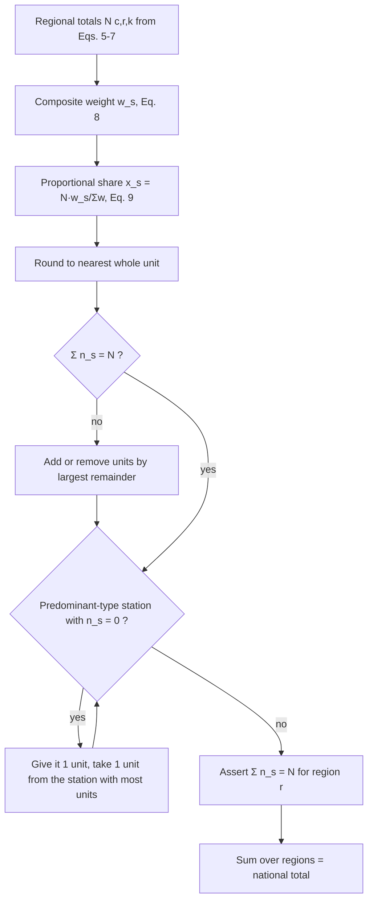

# Station-level allocation: pseudocode and flowchart

This document answers the request for "pseudocode or a flowchart for the allocation and rebalancing procedure" and shows how regional and national totals are preserved (Section 3.2.4 of the revised manuscript). Implementations: `python/ev_planning/allocation.py` and `matlab/reference/allocate_region.m`.

## Pseudocode

```text
INPUT   stations S (4,464 region-assigned, classified), regional totals N[c,r,k] from Eqs. (5)-(7),
        weights w1 = 0.40, w2 = 0.30, w3 = 0.30
OUTPUT  integer chargers n[c,s,k] for every station s, charger type c ∈ {AC, DC}, scenario k

for each charger type c:
    D̂_s ← min-max normalised population density of s
    R̂_s ← 1 − min-max normalised Haversine distance from s to the nearest highway corridor
    T_s ← 1 if class(s) ∈ predominant(c) else 0          # AC: urban, peri-urban; DC: highway, remote
    w_s ← w1·D̂_s + w2·R̂_s + w3·T_s                       # Eq. (8)

for each scenario k, charger type c, region r:
    N ← N[c,r,k]                                          # fixed BEFORE allocation
    x_s ← N · w_s / Σ_{s'∈r} w_s'                         # Eq. (9), real-valued share
    n_s ← round(x_s)                                      # (i) integer rounding, half up
    Δ ← N − Σ n_s                                         # (ii) regional rebalancing
    if Δ > 0: add 1 unit to the Δ stations with the largest remainders x_s − n_s
    if Δ < 0: remove 1 unit from the |Δ| stations (n_s > 0) with the smallest remainders
    for each station s in r with class(s) ∈ predominant(c) and n_s = 0,   # (iii) minimum coverage
            taken in order of decreasing w_s:                             #     (computed share < 0.5)
        d ← station in r with the largest n_d
        if n_d ≤ 1: stop                                  # total too small to cover every station
        n_d ← n_d − 1 ;  n_s ← 1
    assert Σ_{s∈r} n_s = N                                # regional total preserved

N_total,k = Σ_r Σ_c N[c,r,k] = Σ_s Σ_c n[c,s,k]           # national total preserved
```

Each unit given under the minimum-coverage rule is taken from the station that currently holds the most units, so step (iii) never changes the regional total. The assertion is executed for every region, scenario and charger type in both implementations, and `tests/test_framework.py` checks it on 500 random regions and on a full 13-region example.

## Flowchart



## Interpretation

Station counts are *relative siting priorities*. Where the regional total is large relative to the number of mapped stations (for example about 730 chargers per mapped station in Jazan under S4), the figure is an intensity indicator: the surplus has to be met at additional sites (unmapped fuel stations, public car parks, workplaces), not at a single forecourt. `results/station_intensity_S*.csv` lists the chargers per mapped station for every region when the station file is present.
